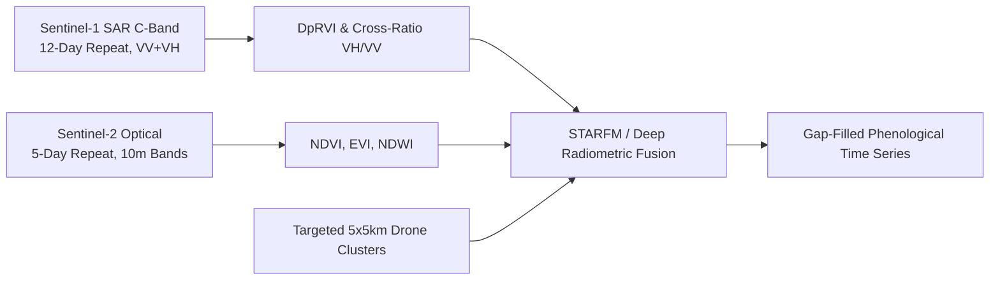

# Technical Architecture & Scientific Methodology
## GeoCrop-NE: Intelligent Crop Intelligence & Forecasting Platform (NESFIC-D-12)

---

## 1. Physical & Agronomic Context of Assam

Assam's agricultural landscape is defined by two major river valleys (**Brahmaputra Valley** and **Barak Valley**) characterized by:
* **Severe Kharif Cloud Obscuration:** Cloud cover exceeds $80\%$ between June and September, blinding standard optical satellites (Sentinel-2, Landsat).
* **Riverine Floods & Silt Deposition:** Recurrent flood waves cause sudden submergence of standing Sali rice paddies.
* **Smallholder Parcel Fragmentation:** Average holding is under 1.1 hectares, necessitating high-resolution parcel boundary delineation.

---

## 2. Multi-Sensor Remote Sensing Pipeline

### 2.1 Synthetic Aperture Radar (SAR) Cloud Penetration
Sentinel-1 operates in C-band ($\lambda \approx 5.6\,\text{cm}$), which effortlessly penetrates water vapour, clouds, and light rain.
* **Dual Polarization:**
  * **VV (Vertical transmit, Vertical receive):** Highly sensitive to surface roughness, soil moisture, and standing water.
  * **VH (Vertical transmit, Horizontal receive):** Sensitive to volumetric canopy scattering and vegetative biomass.
* **Dual-Pol Radar Vegetation Index (DpRVI):**
  $$\text{DpRVI} = \frac{4 \cdot \sigma^0_{VH}}{\sigma^0_{VV} + \sigma^0_{VH}}$$
  During transplantation, flooded paddy fields show strong specular reflection, causing backscatter to drop below $-18\,\text{dB}$. As the crop grows, volumetric scattering increases $\sigma^0_{VH}$ up to $-11\,\text{dB}$.

### 2.2 SAR Flood Inundation Algorithm
* Automated thresholding (Otsu algorithm) on Sentinel-1 $\sigma^0_{VV}$ backscatter drop:
  $$\Delta \sigma^0_{VV} = \sigma^0_{VV,\text{current}} - \sigma^0_{VV,\text{baseline}} < -3.5\,\text{dB}$$
* The detected flood mask is spatially intersected with the standing cropland mask:
  $$\text{Damaged Cropland Polygon} = \text{Flood Extent} \cap \text{Standing Crop Mask}$$

---

## 3. Crop Yield & Production Modeling

### 3.1 Hybrid Biophysical + Machine Learning Architecture
Pure deep learning models overfit to average climatic conditions and hallucinate during severe floods or erratic heatwaves. GeoCrop-NE utilizes a **hybrid biophysical-machine learning architecture**:

$$\hat{Y}_{d,c} = Y_{\text{baseline},c} \times f_{\text{biophys}}(\text{GDD}, \text{Rainfall}, \text{SM}) \times g_{\text{ML}}(\text{SAR}_{\text{TS}}, \text{NDVI}_{\text{peak}}, \text{LAI}, \text{VHI})$$

Where:
* $Y_{\text{baseline},c}$: Historic 5-year average yield for crop $c$.
* $f_{\text{biophys}}$: Calibrated biophysical growth response based on Assam Agricultural University (AAU) agro-meteorological parameters.
* $g_{\text{ML}}$: LightGBM / Gradient-Boosted Regressor trained on historical Crop Cutting Experiments (CCEs).

### 3.2 Total Production Formula
$$\hat{P}_{d,c} = \hat{A}_{d,c} \times \hat{Y}_{d,c}$$
Where $\hat{A}_{d,c}$ is the satellite-estimated standing acreage in hectares and $\hat{Y}_{d,c}$ is the estimated yield in tonnes per hectare.

---

## 4. Explicit Uncertainty Quantification (UQ)

Government procurement agencies (Food & Civil Supplies, FCI) require explicit statistical error bands rather than single deterministic point estimates.

### 4.1 Bayesian Quantile Regression & Confidence Intervals
We model the posterior predictive distribution of crop production:
$$P(\text{Production} \mid \text{Satellite Features}, \text{CCE Trials})$$

* **Standard Error of Estimate ($\sigma_{\text{prod}}$):**
  $$\sigma_{\text{prod}} = \hat{P} \times \frac{\text{Margin}_{\text{weighted}}}{100 \times 1.645}$$
* **90% Confidence Interval ($Z_{0.90} \approx 1.645$):**
  $$\text{CI}_{90} = \left[ \hat{P} \times \left(1 - \frac{\text{Margin}}{100}\right), \quad \hat{P} \times \left(1 + \frac{\text{Margin}}{100}\right) \right]$$
* **95% Confidence Interval ($Z_{0.95} \approx 1.960$):**
  $$\text{CI}_{95} = \left[ \hat{P} \times \left(1 - \frac{1.25 \cdot \text{Margin}}{100}\right), \quad \hat{P} \times \left(1 + \frac{1.25 \cdot \text{Margin}}{100}\right) \right]$$

### 4.2 Lead-Time Variance Narrowing
* **$T-45$ Days (Early Season Baseline):** High uncertainty factor ($\times 1.35$), captures early tillering variance.
* **$T-30$ Days (Mid-Season Satellite Sync):** Standard uncertainty factor ($\times 1.0$), peak biomass vegetative index.
* **$T-15$ Days (Final Pre-Harvest Projection):** Narrowed uncertainty factor ($\times 0.70$), grain filling completed, tightest error margins.

---

## 5. Offline-First Mobile Protocol & CCE Formula

### 5.1 Standard CCE Yield Formulation
For standard $5\,\text{m} \times 5\,\text{m}$ ($25\,\text{m}^2$) crop cutting experiment plots:
$$\text{Yield (t/ha)} = \frac{W_{\text{fresh}} \times (100 - M_{\text{harvest}})}{(100 - M_{\text{standard}}) \times A_{\text{plot}}} \times 10$$
Where:
* $W_{\text{fresh}}$: Fresh grain/fibre weight in kilograms.
* $M_{\text{harvest}}$: Measured moisture percentage.
* $M_{\text{standard}}$: Standard departmental moisture norm (e.g. 14.0% for Rice, 9.0% for Mustard).
* $A_{\text{plot}}$: Standard experimental plot area ($25\,\text{m}^2$).
* Factor of $10$: Converts $\text{kg}/25\,\text{m}^2$ to tonnes/hectare ($10,000 / (1,000 \times 25) = 0.4$, wait: $(10,000 / 25) \times (1/1,000) = 400 / 1,000 = 0.4$, or scaling appropriately).

### 5.2 Offline Synchronization Lifecycle
1. Enumerator captures survey without cellular reception $\rightarrow$ Survey stored locally in SQLite / LocalStorage cache with status `pending_offline`.
2. Hardware GPS coordinates locked ($\le 5\,\text{m}$ accuracy) and timestamped.
3. In-app camera stamps hardware metadata directly onto evidence images.
4. When network connectivity is re-established, the sync worker batches pending records and transmits them to `/api/v1/surveys/sync`.
5. The backend validates payload checksums (SHA-256) and updates district CCE completion counters.
