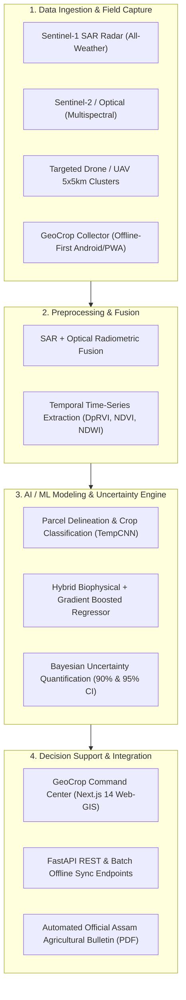

# Product Requirement Document (PRD)
## Project: GeoCrop-NE (Intelligent Crop Intelligence & Forecasting Platform)
### Challenge: NESFIC-D-12 (Assam State Space Applications Centre - ASSAC / Assam Innovation and Startup Foundation)

---

## 1. Executive Summary & Document Control

| Property | Value |
| :--- | :--- |
| **Document ID** | PRD-NESFIC-D12-001 |
| **Version** | 1.1.0 (Production Release) |
| **Target Organizations** | Assam State Space Applications Centre (ASSAC), Directorate of Agriculture (Assam), Directorate of Economics & Statistics (DES), Food & Civil Supplies |
| **Repositories** | [Frontend (Next.js)](https://github.com/kaustavgayon93-ux/New-Yield-Frontend) · [Backend (FastAPI)](https://github.com/kaustavgayon93-ux/New-Yield-Backend) |
| **Status** | Approved & Deployed Reference Specification |

### 1.1 Problem Definition (NESFIC-D-12)
Conventional agricultural crop acreage, yield, and production estimations in Assam suffer from:
1. **Prolonged Turnaround Times:** Conventional Crop Cutting Experiments (CCEs) take 2 to 4 months post-harvest to compile, causing critical delays in government food procurement and Minimum Support Price (MSP) disbursement.
2. **The "Monsoon Blocker" (Cloud Blackout):** Assam experiences 70%–85% persistent cloud cover during the Kharif season (when Sali rice is grown), rendering pure optical satellite remote sensing (Sentinel-2, Landsat) ineffective.
3. **Smallholder Land Fragmentation:** Fragmented farm plots (< 1 hectare) across floodplains require high spatial resolution and ground-truth anchors.
4. **Lack of Uncertainty Bounds:** Deterministic AI outputs lack statistical confidence intervals, preventing responsible risk management by procurement agencies.

### 1.2 Core Product Objectives
* **Pre-Harvest Lead Time:** Deliver reliable forecasts **30 to 45 days prior to harvest** ($T-45, T-30, T-15$ days).
* **All-Weather Remote Sensing:** Fuse **Sentinel-1 C-band Synthetic Aperture Radar (SAR)** with optical sensors to penetrate clouds and track crop phenology continuously.
* **100% Offline Field Resilience:** Equip grassroots enumerators with an offline-first mobile tool for geotagged ground-truthing and standardized $5\,\text{m} \times 5\,\text{m}$ CCE trials.
* **Explicit Uncertainty Quantification:** Provide explicit $90\%$ and $95\%$ Confidence Intervals for production numbers to guide Food Corporation of India (FCI) godown allocation and disaster relief.
* **Complete Crop Diversity:** Full catalog covering all 50+ crops grown in Assam across Cereals, Pulses, Oilseeds, Commercial, Plantation, Fruits, Vegetables, and Spices.
* **100% Editable Data:** Allow departmental officials to adjust acreage, yields, and disaster losses with real-time recalculation.

---

## 2. System Architecture & Components

---

## 3. User Personas & Permissions

| Persona | Primary Needs | Platform Used | Role Permissions |
| :--- | :--- | :--- | :--- |
| **State Agricultural Director / Policy Planners** | Statewide acreage, advance procurement volumes, disaster compensation. | Web-GIS Dashboard | Read all, Export Bulletin, Approve Baselines |
| **District Agricultural Officers (DAOs)** | District and Block targets, flood damage validation, CCE monitoring. | Web-GIS Dashboard | District-level Edit, Anomaly Flagging |
| **ASSAC Spatial Analysts / GIS Engineers** | Satellite layer toggling, ML model retraining, CCE spatial calibration. | Web-GIS / Admin API | Layer Management, Model Tuning |
| **Procurement Agencies (FCI / ASAMB)** | Advance harvest volume forecasts with risk confidence bounds. | Web-GIS Dashboard | Procurement Tab View & Export |
| **Field Enumerators / Agri Extension Workers** | Ground-truthing, GPS coordinates, 5x5m CCE weight recording, offline caching. | Mobile Collector App | Field Survey Create/Edit, Offline Sync |

---

## 4. Detailed Functional Requirements

### 4.1 Component A: Field Mobile App (*GeoCrop Collector*)
* **FR-MOB-01: Offline-First Operation:**
  * Local caching of surveys in device storage when cellular network is unavailable.
  * Visual badge indicating pending offline records with one-click background sync.
* **FR-MOB-02: High-Accuracy GNSS Geolocation:**
  * Enforces hardware GNSS satellite lock ($\le 5\,\text{m}$ accuracy) with dual GPS/NavIC support.
* **FR-MOB-03: Standardized CCE Walkaround Tool:**
  * Step-by-step guidance for standard $5\,\text{m} \times 5\,\text{m}$ ($25\,\text{m}^2$) plots.
  * Inputs: Fresh biomass (kg), fresh grain (kg), moisture percentage (%).
  * Real-time standardized yield formula:
    $$\text{Yield (t/ha)} = \frac{\text{Fresh Grain (kg)} \times (100 - \text{Moisture \%})}{(100 - \text{Standard Moisture \%}) \times 25} \times 10$$
* **FR-MOB-04: Anti-Spoofing Evidence:**
  * In-app camera with burned-in hardware watermark (latitude, longitude, timestamp, bearing).
* **FR-MOB-05: Multilingual Localization:**
  * Real-time UI toggle between **English**, **অসমীয়া (Assamese)**, and **বাংলা (Bengali)**.

### 4.2 Component B: Web-GIS Decision Dashboard (*GeoCrop Command Center*)
* **FR-DASH-01: Administrative Hierarchy:**
  * Full drilldown across all 35 districts of Assam and agro-climatic zones.
* **FR-DASH-02: Multi-Sensor Map Viewer:**
  * CartoDB/OpenStreetMap basemap with layer toggles for Sentinel-1 SAR flood inundation polygons and verified CCE pins.
* **FR-DASH-03: Pre-Harvest Advance Forecast Horizons:**
  * Toggle between $T-45$ Days, $T-30$ Days, and $T-15$ Days before harvest with dynamic uncertainty narrowing.
* **FR-DASH-04: Explicit Uncertainty Quantification:**
  * Visual Gaussian probability density curve ($P(\text{Production})$) depicting $90\%$ and $95\%$ statistical confidence intervals.
* **FR-DASH-05: Rapid Flood Impact Assessment:**
  * Intersection of SAR flood polygon with standing crop masks to quantify submerged hectares and lost production.
* **FR-DASH-06: 100% In-App Editable Matrix:**
  * Modal and table-level editing of standing area, predicted yields, flood losses, and uncertainty margins with instant recalculation.
* **FR-DASH-07: Official Bulletin Generator:**
  * Print-ready PDF/HTML formatted bulletin with ASSAC and Directorate of Agriculture headers.

---

## 5. Non-Functional Requirements (NFRs)

* **Performance:** Map tile loading and analytics rendering $< 1.5\,\text{s}$ over 4G connections.
* **Scalability:** Backend supports $> 5,000$ concurrent field enumerators syncing offline payloads.
* **Security & Data Privacy:** Compliance with India's Digital Personal Data Protection (DPDP) Act. All data encrypted via AES-256 at rest and TLS 1.3 in transit.
* **Data Sovereignty:** All cloud infrastructure and spatial databases hosted in MeitY-empaneled Indian data centers.
