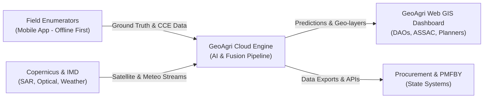
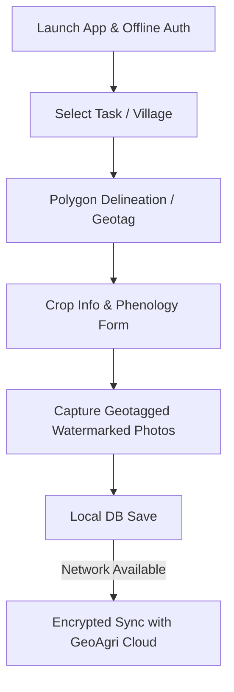
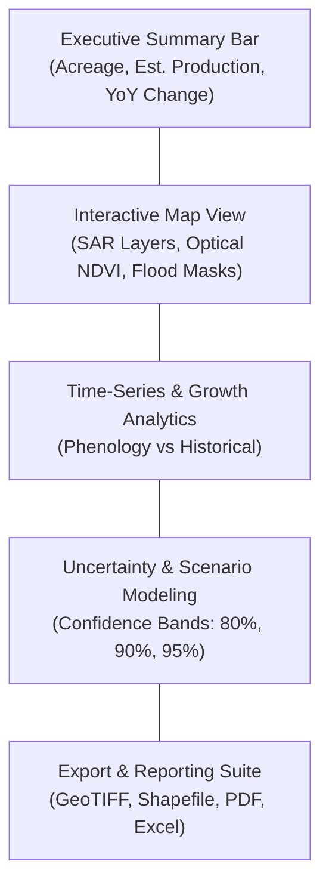
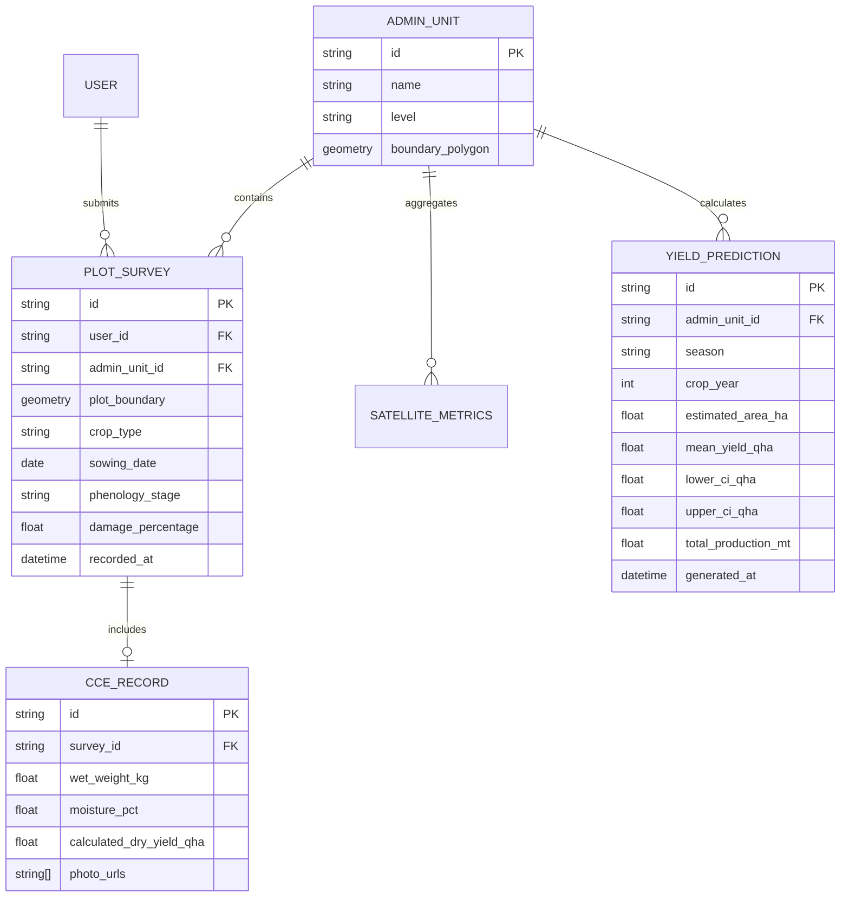

# Product Requirements Document (PRD)
## Project: GeoAgri-Assam (NESFIC-D-12)
**Multi-Modal Earth Observation & AI-Driven Crop Intelligence Platform**

---

## 1. Document Control & Metadata
* **Project Name:** GeoAgri-Assam
* **Problem Statement Reference:** NESFIC-D-12 (Stream 1)
* **Lead Institutions / Sponsoring Entities:** Assam State Space Applications Centre (ASSAC), Directorate of Agriculture (Government of Assam)
* **Target Audience:** Product managers, software engineers, GIS scientists, UI/UX designers, and government technical evaluators
* **Version:** 1.1.0
* **Status:** Approved for Implementation

---

## 2. Executive Summary & Vision

### 2.1 Product Vision
To build a state-grade, all-weather agricultural intelligence platform that combines cloud-penetrating Synthetic Aperture Radar (SAR), multi-spectral optical satellite data, agrometeorological indicators, and geotagged field observations. The platform provides government departments with accurate, repeatable, and timely crop acreage, yield forecasts, and total production estimates across village, block, and district levels.

### 2.2 Core Deliverables
The ecosystem comprises two interconnected user-facing software products:
1. **GeoAgri Field App (Mobile - Android/iOS):** An offline-first mobile app for field enumerators and village extension workers to capture geotagged field validations, crop stages, and Crop Cutting Experiment (CCE) records.
2. **GeoAgri Portal (Web GIS Dashboard):** A high-performance browser-based spatial intelligence dashboard for District Agricultural Officers (DAOs), state planners, ASSAC scientists, and procurement agencies (FCI, ASAMB).



---

## 3. User Personas & Target Stakeholders

| Persona | Role | Primary Need | Key Pain Points |
|---|---|---|---|
| **P1: Field Enumerator / VLEW** | Village Level Extension Worker | Fast, reliable geotagging and CCE entry in the field. | Poor mobile network connectivity in remote/char areas, complex forms, battery drain. |
| **P2: District Agriculture Officer (DAO)** | Administrative lead at district level | Early production alerts, block-level acreage progress, flood impact reports. | Delayed manual paperwork, inability to verify field reports visually. |
| **P3: ASSAC Remote Sensing Scientist** | Technical geospatial evaluator | Layer verification, model uncertainty calibration, raw spectral/radar backscatter inspection. | Black-box ML outputs, lack of ground-truth cross-referencing tools. |
| **P4: Procurement & Planning Agency (FCI / ASAMB)** | Supply chain & MSP procurement | 3–4 weeks pre-harvest grain production forecasts with confidence intervals. | Post-harvest reporting arrives 2–3 months too late to arrange logistics and procurement funds. |

---

## 4. Mobile Application: "GeoAgri Field App"

### 4.1 System Specifications
* **Platforms:** Android 9.0+ (primary focus for government-issued devices) and iOS 15+.
* **Design Pattern:** Offline-first architecture using local SQLite / WatermelonDB, syncing via background workers when network is available.
* **Localization:** English and Assamese (with audio prompt support).

### 4.2 Functional Requirements (Mobile)



#### FR-M01: Offline-First Authentication & Local Data Caching
* **Requirement:** Users must be able to log in using biometric/PIN authentication when offline after an initial authenticated sync.
* **Capabilities:** Pre-download assigned village boundary shapes, farmer rosters, and crop schedules for the assigned revenue circles.

#### FR-M02: Farm Parcel Area Collection & Boundary Delineation (Bigha-Katha-Lessa)
* **Requirement:** Enable enumerator to capture plot boundary coordinates and calculate physical parcel area using device GPS (under 3 meters accuracy threshold).
* **Dual Area Collection Modes:**
  * **Mode A: "Walk-the-Field" GPS Polygon Tracking:** The enumerator activates tracking and walks the perimeter of the field. GPS vertices are logged every 2–3 meters with automatic polygon closure upon returning to the start point.
  * **Mode B: Manual Map Tapping on Offline Basemap:** For flooded, silted, or physically inaccessible parcels (e.g., riverine *char* lands), the enumerator taps corner vertices on cached high-resolution satellite basemaps.
* **Automatic Multi-Unit Area Calculation:**
  * Computes geometric polygon area on-device using spherical polygon geodesics (EPSG:4326 / UTM 46N).
  * Automatically converts and displays area in local Assam land revenue units:
    * **1 Bigha = 5 Kathas = 100 Lessas ≈ 1,337.8 sq. meters (14,400 sq. feet)**
    * **1 Katha = 20 Lessas ≈ 267.56 sq. meters**
    * **Standard Conversion:** Auto-computes equivalent in **Hectares (ha)** and **Acres** for state planning and AI pipeline calibration.
* **Cadastral & Land Record Cross-Referencing:**
  * Links plot boundaries with Dag number, Patta number, and farmer landholding records aligned with the Assam *Dharitree* revenue database where digitized cadastral maps exist.

#### FR-M03: Ground Truth Survey & Crop Phenology
* **Requirement:** Standardized entry form for seasonal crop observations.
* **Fields:** Crop type (dropdown of Assam priority crops: Sali, Boro, Ahu paddy, Mustard, Jute, Potato, etc.), sowing date, variety, phenological stage (germination, vegetative, flowering, maturity, harvested), and health rating.

#### FR-M04: Digital Crop Cutting Experiment (CCE) Capture
* **Requirement:** Standardized digital CCE workflow replacing manual paper registers.
* **Workflow:** Plot dimension entry (5m × 5m standard cut), wet harvest weight, sample moisture percentage, dry weight calculation, and automatic tamper-evident EXIF timestamping.

#### FR-M05: Camera Capture with Anti-Spoofing & Geotag Watermark
* **Requirement:** Capture up to 4 high-resolution photos per plot.
* **Security:** Mandatory embedded watermark showing latitude, longitude, compass bearing, timestamp, and user ID. Mock-location and gallery upload detection enabled.

#### FR-M06: Flood & Calamity Rapid Assessment Module
* **Requirement:** Rapid one-click disaster reporting tool during monsoon floods.
* **Inputs:** Inundation status (submerged, silt-deposited, partially damaged), estimated crop submergence depth, and days under water.

---

## 5. Web GIS Dashboard: "GeoAgri Portal"

### 5.1 System Specifications
* **Target Clients:** Modern web browsers (Chrome, Edge, Firefox, Safari) on desktop, laptop, and tablet screens.
* **GIS Engine:** WebGL-accelerated mapping via Mapbox GL JS / OpenLayers with Vector Tile support.
* **Role-Based Views:** Executive overview for senior planners; deep geospatial analysis view for ASSAC analysts.

### 5.2 Functional Requirements (Web Dashboard)



#### FR-W01: Macro KPI & Executive Summary Bar
* Displays dynamic, real-time counters at selected administrative scale:
  * **Total Estimated Acreage (ha)** vs Department Target.
  * **Pre-Harvest Forecasted Production (MT)**.
  * **Current Mean Crop Health Index** vs 5-year baseline.
  * **Flood/Weather Impacted Area (ha)**.

#### FR-W02: Multi-Layer Interactive Map Canvas
* **Base Maps:** High-resolution satellite basemap, OpenStreetMap, and Survey of India layers.
* **Overlay Layers (Toggleable):**
  * Administrative boundaries (State → District → Subdivision → Block → Revenue Circle → Village).
  * Crop Classification Mask (color-coded by crop type).
  * Synthetic Aperture Radar (Sentinel-1 VV/VH backscatter anomaly layer).
  * Optical Chlorophyll/Vegetation Index (NDVI / NDRE raster layer).
  * Flood Inundation & Siltation Mask.
  * CCE Ground Sampling point clusters (with popup detail of cut yields).

#### FR-W03: Temporal Phenology & Growth Curve Analyzer
* Clicking any district, block, or custom polygon plots a comparative time-series chart:
  * Current season SAR backscatter / NDVI progression curve.
  * Historical normal progression curve (5-year rolling median).
  * Real-time anomaly deviation indicator (flagging delayed sowing or stressed growth).

#### FR-W04: Yield Prediction & Uncertainty Quantification Panel
* **Requirement:** Provide probabilistic yield and production estimates rather than opaque static figures.
* **Features:**
  * Displays mean yield (q/ha) alongside lower and upper confidence bounds (e.g., 90% confidence interval).
  * Interactive slider allowing officials to evaluate optimistic vs. pessimistic procurement scenarios based on upcoming weather forecasts.

#### FR-W05: Automated Report Generation & Data Export
* **One-Click Dossier Export:** Instant generation of executive PDF briefing sheets for District Commissioners (DCs) and Agriculture Ministers.
* **GIS Layer Export:** Download crop masks and yield distribution maps in OGC-compliant formats: GeoTIFF, ESRI Shapefile, GeoJSON.
* **Tabular Export:** CSV/XLSX downloads containing block-wise aggregated figures.

#### FR-W06: System Administration & User Management
* Tiered role-based access control (RBAC):
  * **Super Admin:** ASSAC IT administrator.
  * **State Viewer:** Commissioner & Secretary of Agriculture, Managing Director (ASAMB).
  * **District Admin:** District Agriculture Officer (DAO) for district validation and field enumerator task assignment.
  * **Field Supervisor:** Approves and verifies mobile survey entries.

---

## 6. Non-Functional Requirements (NFRs)

### 6.1 Performance & Latency
* **Map Render Time:** Vector tile layers and raster tiles render in under 1.5 seconds under standard 4G broadband conditions.
* **Query Latency:** Aggregation queries for district-level summaries complete in under 800 ms.
* **Mobile App Cold Start:** Launches to interactive state in under 2 seconds.
* **Sync Throughput:** Mobile app synchronizes 100 geotagged records with images in under 30 seconds on 3G/4G connectivity.

### 6.2 Security, Compliance & Data Governance
* **MeitY & MeghRaj Compliance:** Hosting infrastructure complies with Ministry of Electronics and Information Technology (MeitY) guidelines.
* **Encryption Standards:** TLS 1.3 for all data in transit; AES-256 for data at rest in the database and local mobile cache.
* **Anonymization:** Land possession details and individual farmer identities are scrubbed from public or non-authorized export tiers.
* **Audit Trail:** Every manual yield override, shapefile edit, or survey approval maintains an immutable log with user ID and timestamp.

### 6.3 Availability & Reliability
* **High Availability:** 99.9% uptime during peak Kharif and Rabi harvest cycles (October–December and April–May).
* **Fault Tolerance:** Automated daily backups of geospatial databases with 1-hour Recovery Point Objective (RPO) and 4-hour Recovery Time Objective (RTO).

---

## 7. Satellite Data & Earth Observation (EO) Specifications (USPR Requirement 7)

To solve the dual challenges of heavy monsoon cloud cover and smallholder plot fragmentation in Assam, the platform integrates a multi-sensor satellite data architecture that fuses microwave radar, multi-spectral optical, and micro-sampling UAV inputs.

### 7.1 Multi-Constellation Satellite Data Matrix

| Constellation & Sensor | Spectral Bands / Modes | Spatial Resolution | Temporal Revisit | Primary Function in GeoAgri-Assam | Data Source & Access Tier |
|---|---|---|---|---|---|
| **Sentinel-1 SAR** (C-Band Synthetic Aperture Radar) | Level-1 GRD, IW mode, Dual-Polarization (VV + VH) | 10 meters | 6–12 days | **All-weather monsoon monitoring:** Cloud-penetrating crop acreage, paddy transplanting detection, flood inundation masking. | Free & Open (Copernicus Data Space Ecosystem) |
| **Sentinel-2 MSI** (Multi-Spectral Instrument) | Level-2A BOA Surface Reflectance, 13 Bands (B2–B12) | 10m (RGB/NIR), 20m (Red Edge/SWIR) | 5 days (under clear sky) | **Crop health & chlorophyll:** Sali/Boro paddy phenology, vegetative vigor, canopy nitrogen, moisture stress during clear windows. | Free & Open (Copernicus Data Space Ecosystem) |
| **Landsat 8 & 9** (OLI-2 & TIRS-2) | 8 Spectral + 2 Thermal Bands | 30 meters (Thermal: 100m resampled) | 8–16 days | **Long-term historical baselines:** 5-year trend calibration, land surface temperature (LST), multi-year crop rotation history. | Free & Open (USGS / NASA EarthExplorer) |
| **ISRO Resourcesat-2/2A** (LISS-III / LISS-IV) | Multi-Spectral (Green, Red, NIR, SWIR) | 5.8m (LISS-IV), 23.5m (LISS-III) | 5–24 days | **High-resolution parcel calibration:** State benchmark alignment and cadastral boundary correlation. | Departmental access via ASSAC / NRSC Bhuvan portal |
| **NASA-ISRO NISAR** (Dual-frequency L & S Band SAR) | Dual/Quad Polarization, Repeat-pass InSAR | 3–10 meters | 12 days | **Advanced biomass & soil moisture:** Deep canopy penetration through mature paddy and flood recession profiling. | Open Public Science Data (Ingestion-ready pipeline) |
| **High-Resolution UAV / Drones** | RGB + 5-band Multispectral (Red, Green, Blue, RedEdge, NIR) | under 5 cm | On-Demand (Spot-check) | **Sub-pixel ground calibration:** Micro-plot training over representative smallholder clusters in pilot blocks. | State-provided sample flights / Project UAV sampling |

---

### 7.2 Satellite Pre-Processing & Calibration Pipeline

All incoming raw scenes pass through an automated geospatial processing pipeline before ingestion into AI models:

```
[Raw Sentinel-1 SAR Level-1 GRD]
  ├── 1. Apply Orbit File (Precise Orbit Ephemerides .EOF)
  ├── 2. Thermal Noise Removal
  ├── 3. Radiometric Calibration (Generate Sigma Nought σ° and Gamma Nought γ° in decibels)
  ├── 4. Speckle Filtering (Refined Lee 5×5 adaptive filter)
  └── 5. Range-Doppler Terrain Correction (SRTM / Copernicus 30m Global DEM)
          └── Output: 10m Cloud-Optimized GeoTIFF (COG) in EPSG:4326 / EPSG:32646 (UTM 46N)

[Raw Sentinel-2 Level-2A BOA Reflectance]
  ├── 1. Scene Classification Layer (SCL) Cloud & Shadow Masking (s2cloudless algorithm)
  ├── 2. Atmospheric & Aerosol Quality Filtering (Masking clouds, cirrus, and shadow pixels)
  └── 3. 10-Day Medoid Time-Series Compositing (Generating gap-free cloudless mosaics)
          └── Output: Standardized 10m Multi-Spectral Surface Reflectance Cubes
```

---

### 7.3 Engineered Satellite Features & Crop Indices

The AI engine extracts a multi-dimensional feature tensor for every agricultural parcel across the season:

1. **Radar Backscatter Descriptors:**
   * **Vertical Co-polarization (VV):** Sensitive to soil moisture and rough standing water during land preparation and transplanting.
   * **Cross-polarization (VH):** Sensitive to volume scattering from growing crop canopies and vegetative biomass.
   * **Polarization Ratio (VH / VV):** Mitigates soil moisture noise; directly correlates with vertical crop canopy structure and stem elongation.
   * **Dual-Polarization Radar Vegetation Index (DpRVI):** Normalized radar vegetation index ranging from 0 (bare soil/water) to 1 (dense crop canopy).
   * **Temporal Delta (Δσ°):** Detects abrupt drops in backscatter indicating flood inundation or harvest events.

2. **Optical Multi-Spectral Indices:**
   * **Normalized Difference Vegetation Index (NDVI):** Overall vegetative greenness and biomass trajectory.
   * **Normalized Difference Red Edge (NDRE):** Sensitive to chlorophyll concentration in dense, closed canopies where standard NDVI saturates.
   * **Normalized Difference Water Index (NDWI):** Canopy water content and field submergence profiling.
   * **Green Chlorophyll Vegetation Index (GCVI):** Pre-harvest grain fill and leaf senescence monitoring.

---

### 7.4 Automated Crop Area (Acreage) Estimation & Flood Deduction Engine

The calculation of net crop area (hectares) is performed through an automated geospatial classification pipeline designed specifically for Assam's agro-climatic conditions:

1. **Temporal SAR Transplanting Inundation Detection:**
   * During the monsoon Kharif season, Sali paddy is transplanted into flooded/puddled soil.
   * Sentinel-1 SAR captures the sharp temporal backscatter dip (co-polarized VV backscatter drops below -16 dB due to specular reflection off standing water) followed by a steep increase as vegetative tillers emerge.
   * The algorithm identifies the exact **transplanting date window** and delineates the **net sown paddy area** regardless of 100% cloud cover.

2. **Pixel-Level & Object-Based Crop Classification:**
   * Utilizes a temporal 1D-CNN and Random Forest classifier trained on the multi-sensor feature stack (SAR VV/VH time-series + Optical NDVI/NDRE when available).
   * Generates a 10m-resolution categorical raster distinguishing:
     * **Sali Paddy** (Winter rice)
     * **Ahu Paddy** (Autumn rice)
     * **Boro Paddy** (Summer irrigated rice)
     * **Rape & Mustard** (Major winter oilseed)
     * **Jute** (Fiber crop)
     * **Maize & Pulses**
     * **Tea Estates** (Perennial baseline mask)
     * **Fallow / Uncultivated Lands**

3. **Dynamic Flood Inundation & Siltation Area Deduction:**
   * Cross-references real-time SAR flood masks during peak flood waves along the Brahmaputra and Barak river basins.
   * Cropland pixels submerged for more than 7 consecutive days or covered by heavy silt deposits are tagged as damaged and **dynamically deducted** from the net harvestable acreage.

4. **Hierarchical Acreage Aggregation & Administrative Rollup:**
   * Sums classified 10m pixels (each pixel = 0.01 hectares = 0.0747 bighas) within official administrative boundaries.
   * Aggregates acreage figures with confidence error margins:
     > **Village → Gram Panchayat → Revenue Circle → Block → District → State**
   * Outputs comparison against departmental sowing targets and previous 5-year averages.

---

### 7.5 Data Volume, Pipeline Cadence & Storage Footprint

* **Spatial Coverage Area:** Entire State of Assam (~78,438 sq. km), focused on ~3.8 million hectares of net cultivable area across 35 districts.
* **Ingestion Cadence:**
  * Sentinel-1 SAR: Processed every 6–12 days upon catalog publication (within 12 hours of acquisition).
  * Sentinel-2: Ingested every 5 days; cloud-masked composites compiled bi-weekly.
  * Agrometeorological Data: Daily automated sync with IMD gridded datasets and ERA5 reanalysis (rainfall, min/max temp, relative humidity).
* **Storage Footprint:**
  * Active Season Imagery: Approximately 1.4 TB of processed Cloud-Optimized GeoTIFFs (COGs) per season.
  * Spatiotemporal Indexing: Managed via SpatioTemporal Asset Catalog (STAC) compliant metadata in PostGIS / pgSTAC.

---

### 7.6 Data Governance, Access Permissions & Dependencies

In accordance with government procurement guidelines, data dependencies are categorized explicitly:
* **Confirmed Open-Access Dependencies:** Copernicus Sentinel-1 and Sentinel-2, USGS Landsat 8/9, NASA DEM, and IMD/ERA5 climate data are 100% open-access and require no state licensing fees.
* **Departmental Data (Subject to Administrative Permission):** Historical CCE survey registers, digitized district/circle boundaries, and past agricultural statistics are assumed accessible upon MOU signing with the Directorate of Agriculture and ASSAC.
* **Proprietary Independence:** The core solution does not depend on proprietary commercial satellite constellations (e.g., Planet, Maxar), ensuring zero recurring foreign imagery licensing costs for the state government.

---

## 8. System Data Architecture, Database Models & API Specifications

### 8.1 Core Data Entity Relationship



### 8.2 Core REST API Endpoints

| Method | Endpoint | Description | Auth Level |
|---|---|---|---|
| `POST` | `/api/v1/auth/login` | Authenticate user, issue JWT with roles | Public |
| `POST` | `/api/v1/mobile/sync` | Batch upload offline surveys and CCE records | Enumerator / Field Officer |
| `GET` | `/api/v1/mobile/tasks` | Fetch assigned villages and baseline boundaries | Enumerator |
| `GET` | `/api/v1/analytics/summary` | Query aggregated KPIs by district, year, season | District / State Admin |
| `GET` | `/api/v1/analytics/timeseries` | Retrieve SAR/NDVI time-series curves for polygon | All Authenticated |
| `GET` | `/api/v1/gis/wms` | OGC-compliant Web Map Service for raster layers | GIS Analyst / Public Layers |
| `POST` | `/api/v1/export/report` | Generate automated executive PDF summary | District / State Admin |

---

## 9. Screen Layout & Wireframe Specifications

### 9.1 Mobile App UI Structure ("GeoAgri Field App")

The mobile UI is designed for outdoor daylight readability, high contrast, and rapid one-handed data entry.

#### Screen 1: Field Dashboard & Task List
* **Header Bar:** Offline indicator pill (`ONLINE` or `OFFLINE: 14 Pending Sync`), current Village/Block selector, and sync action button.
* **Primary Quick Actions (Large Touch Targets):**
  * `[ + Record New Field Observation ]` – launches GPS boundary walking & phenology form.
  * `[ Digital CCE Entry ]` – launches Crop Cutting Experiment recording sequence.
  * `[ Report Flood / Damage ]` – quick assessment tool for inundated parcels.
* **Assigned Surveys Feed:** Card-based list showing assigned survey plots with status badges (`Verified`, `Pending Sync`, `CCE Assigned`).

#### Screen 2: Digital Crop Cutting Experiment (CCE) Form
* **Plot Identification Card:** Displays Plot ID, Farmer Name, Crop Variety, and GPS centroid with lock-in status (under 3 meters accuracy check).
* **Measurement Input Fields:**
  * Standard Plot Dimension selector (5m × 5m default).
  * Wet Harvest Weight (kg) with numeric keypad input.
  * Moisture Meter Reading (%).
  * Calculated Dry Weight (automatic real-time calculation in quintals/hectare).
* **Tamper-Evident Media Capture:**
  * Mandatory Photo 1: Harvested area with measuring tape.
  * Mandatory Photo 2: Digital weighing scale display with geotagged EXIF watermark.
* **Sticky Action Button:** `[ Save CCE Record (Offline Cache) ]`.

---

### 9.2 Web GIS Portal Dashboard Structure ("GeoAgri Portal")

The desktop portal utilizes a 3-pane layout optimized for wide displays and administrative decision-making:

#### 1. Top Navigation & Filter Bar
* Global selector for: **State (Assam)** → **District** (e.g., Nagaon, Kamrup) → **Season** (Kharif 2026) → **Crop Type** (Sali Paddy, Mustard).
* Timestamp of latest satellite pass (e.g., *"Sentinel-1 SAR updated 14 hrs ago"*).
* User Profile & Role badge (e.g., `District Agriculture Officer - Nagaon`).

#### 2. Left KPI & Summary Panel (Width: 280px)
* **Estimated Acreage:** Total hectarage classified with percentage of district target.
* **Mean Yield Forecast:** Yield in quintals/hectare with error margin (± 2.1 q/ha).
* **Total Production Forecast:** Metric tonnes with 90% confidence interval bounds.
* **Disaster / Inundation Alert:** Hectares of crop area impacted by floodwaters.

#### 3. Central Interactive Map Canvas (Dynamic Flex)
* **Map Controls:** Layer switcher (Base Map, Sentinel-1 SAR Backscatter, Sentinel-2 NDVI, Crop Type Classification, Flood Inundation Mask, CCE Ground Points).
* **Interactive Tooltips:** Clicking any administrative polygon displays instantaneous acreage, crop health curve, and progress metrics.
* **Time-Slider:** Step through weekly satellite acquisitions across the growing season.

#### 4. Right Analytical Deep-Dive Drawer (Width: 320px, Collapsible)
* **Phenology Profile:** Temporal curve comparing current season NDVI/SAR against 5-year historical median.
* **CCE Validation Tracker:** Real-time progress bar (e.g., `324 / 400 CCEs completed`, 89.2% model correlation).
* **Export Action Suite:** One-click downloads for Executive PDF Briefs, GeoTIFF raster layers, and Excel block summaries.

---

## 10. Pilot Execution, Phased Rollout & Success KPIs

### 10.1 Phased Implementation Roadmap
* **Phase 1: Alpha Development & Lab Testing (Months 1–3)**
  * Finalize mobile app offline storage engine and Web GIS canvas.
  * Calibrate cloud-penetrating Sentinel-1 SAR pre-processing with historical CCE datasets.
* **Phase 2: District Field Pilot (Months 4–6)**
  * Deploy mobile app to 100 field extension workers in **Kamrup** and **Nagaon** districts.
  * Run parallel pre-harvest yield predictions 4 weeks ahead of Kharif harvest.
* **Phase 3: State-Wide Rollout & API Handover (Months 7–9)**
  * Extend coverage across all 35 districts of Assam.
  * Integrate REST data exchange with ASSAC portals and state civil supply dashboards.

### 10.2 Measurable Success Metrics (KPIs)
1. **Prediction Accuracy:** Production forecasts achieve ≥ 88% correlation (R² ≥ 0.78) against finalized state CCE statistics.
2. **Timeliness:** Comprehensive district-level production forecasts delivered at least **21 days prior to harvest**.
3. **Operational Adoption:** ≥ 90% of assigned field surveys synchronized successfully via the mobile app with zero data loss in offline mode.
4. **Cloud-Coverage Resilience:** Zero failure in temporal crop phenology tracking despite continuous monsoon cloud cover during June–August.

---

## 11. Team, Manpower Allocation & Technical Expertise (USPR Requirement 8)

To ensure the solution is delivered within the timeline and complies with the government's rigorous technical standards, the project team is structured with specialized geospatial, AI, and agronomic domain expertise.

### 11.1 Core Roles & Key Responsibilities

| Role | Profile & Key Responsibilities | Critical Specialist Skills |
|---|---|---|
| **Lead Remote Sensing & GIS Scientist** | Leads satellite pipeline architecture, radiometric calibration, and SAR backscatter feature engineering for monsoon cloud penetration. | Sentinel-1 SAR polarimetry (VV/VH), multi-sensor fusion, SNAP/GDAL/GEE automation, ASSAC data alignment. |
| **Agricultural AI/ML Modeler** | Designs parcel classification models and crop yield prediction engines using temporal deep learning and Bayesian/Gaussian Process regression. | Time-series ML (XGBoost/LightGBM, 1D-CNN), crop growth modeling (WOFOST/AquaCrop), uncertainty quantification. |
| **Lead Geospatial Full-Stack Engineer** | Architects the Web GIS Portal, OGC tile servers (GeoServer/Vector Tiles), and high-performance PostGIS spatial queries. | WebGL/Mapbox GL JS, PostGIS optimization, FastAPI microservices, Docker, MeitY cloud compliance. |
| **Mobile Application Engineer** | Develops the offline-first "GeoAgri Field App", local database caching, background synchronization, and anti-spoofing camera tools. | Android Native / Flutter, SQLite/WatermelonDB, GPS hardware integration, offline queueing patterns. |
| **Field Agronomist & CCE Coordinator** | Coordinates ground-truth surveys with Assam Agricultural University (AAU) and District Agriculture Officers (DAOs); oversees field testing. | Assam cropping calendars (Sali, Ahu, Boro paddy, mustard), CCE standard protocols, local language training (Assamese/Bengali). |
| **GIS QA & Cloud Security Specialist** | Ensures data validation, system load testing, role-based access security, and MeghRaj / ISO 27001 compliance. | Geospatial topology validation, OWASP security, automated CI/CD, data encryption & anonymization. |

---

### 11.2 Manpower Allocation Matrix by Development Phase

| Role | Phase 1: Lab & Alpha (Months 1–3) | Phase 2: District Pilot (Months 4–6) | Phase 3: Rollout & Handover (Months 7–9) | Total Effort (Person-Months) |
|---|:---:|:---:|:---:|:---:|
| **Lead Remote Sensing Scientist** | 100% (Full-Time) | 100% (Full-Time) | 50% (Part-Time) | 7.5 PM |
| **Agricultural AI/ML Modeler** | 100% (Full-Time) | 100% (Full-Time) | 50% (Part-Time) | 7.5 PM |
| **Geospatial Full-Stack Engineer** | 100% (Full-Time) | 100% (Full-Time) | 100% (Full-Time) | 9.0 PM |
| **Mobile Application Engineer** | 100% (Full-Time) | 75% (Substantial) | 50% (Part-Time) | 6.75 PM |
| **Field Agronomist / CCE Lead** | 50% (Part-Time) | 100% (Full-Time - On Site) | 50% (Part-Time) | 6.0 PM |
| **GIS QA & Cloud Security Engineer** | 50% (Part-Time) | 75% (Substantial) | 100% (Full-Time) | 6.75 PM |
| **Total Equivalent Manpower** | **5.0 FTE** | **5.5 FTE** | **4.0 FTE** | **43.5 Person-Months** |

---

### 11.3 Domain Advisory & Institutional Linkages
* **State Remote Sensing Collaboration:** Technical alignment meetings scheduled bi-weekly with **ASSAC** (Assam State Space Applications Centre) to ensure full compatibility with state geospatial data frameworks.
* **Academic Agronomy Advisory:** Scientific consultation with researchers from **Assam Agricultural University (AAU, Jorhat)** for local cultivar parameters, phenological thresholds, and crop disease impact validation.
* **Capacity Building & Training:** A structured 2-week training curriculum designed for District Agriculture Officers (DAOs), Sub-Divisional Agriculture Officers (SDAOs), and Village Level Extension Workers (VLEWs) prior to district pilot deployment.
